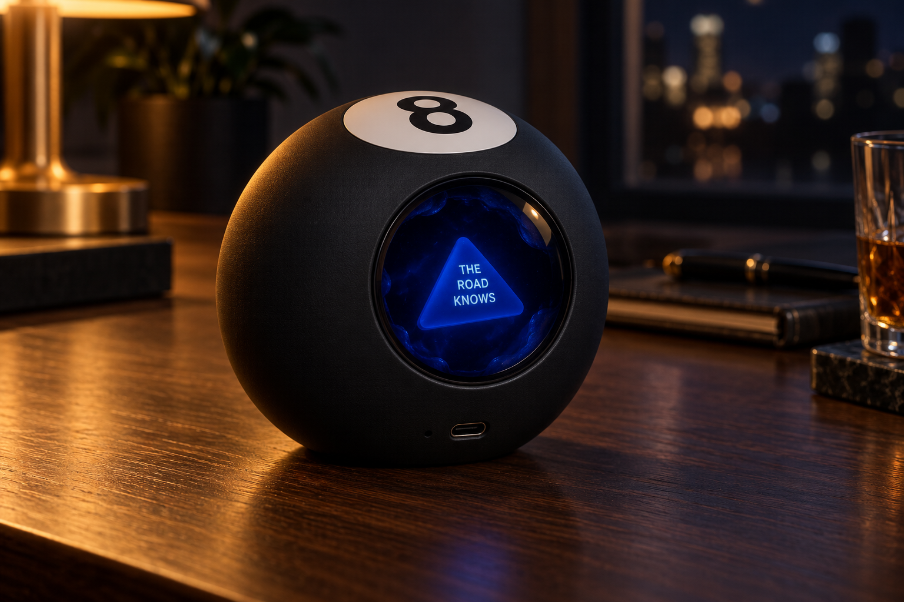
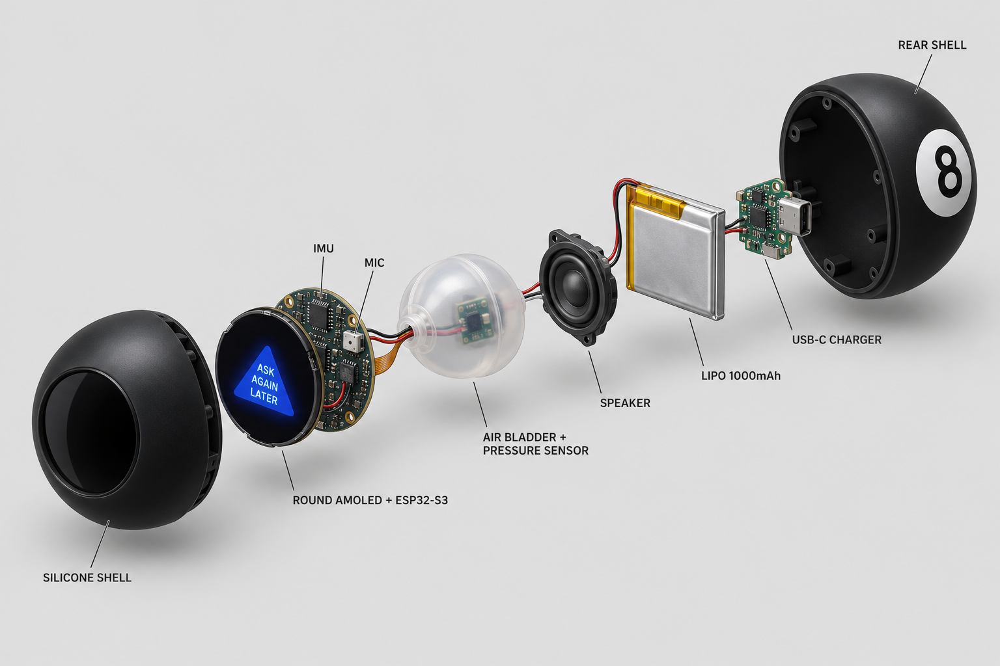
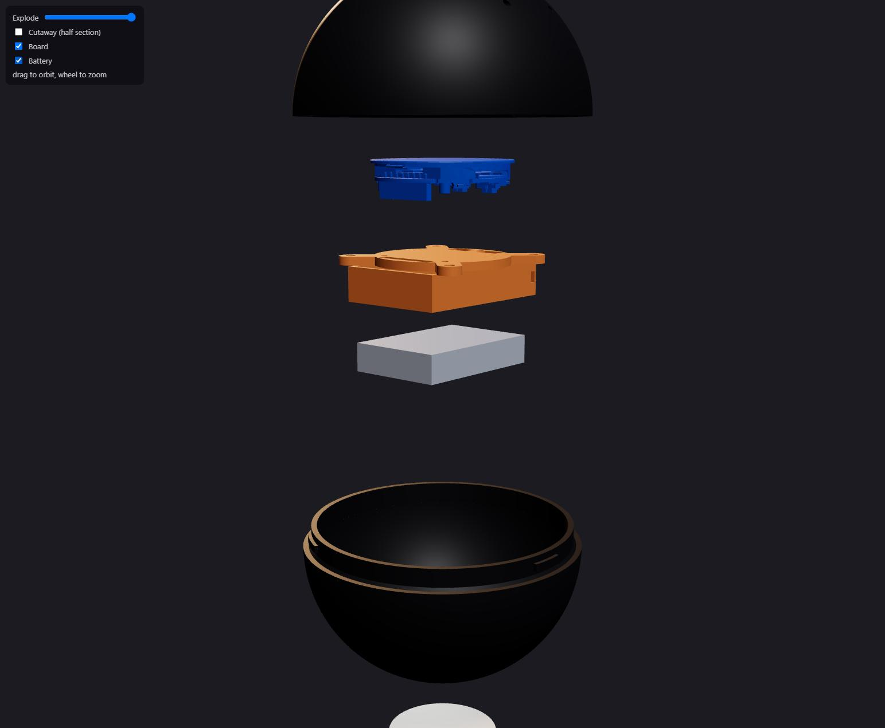
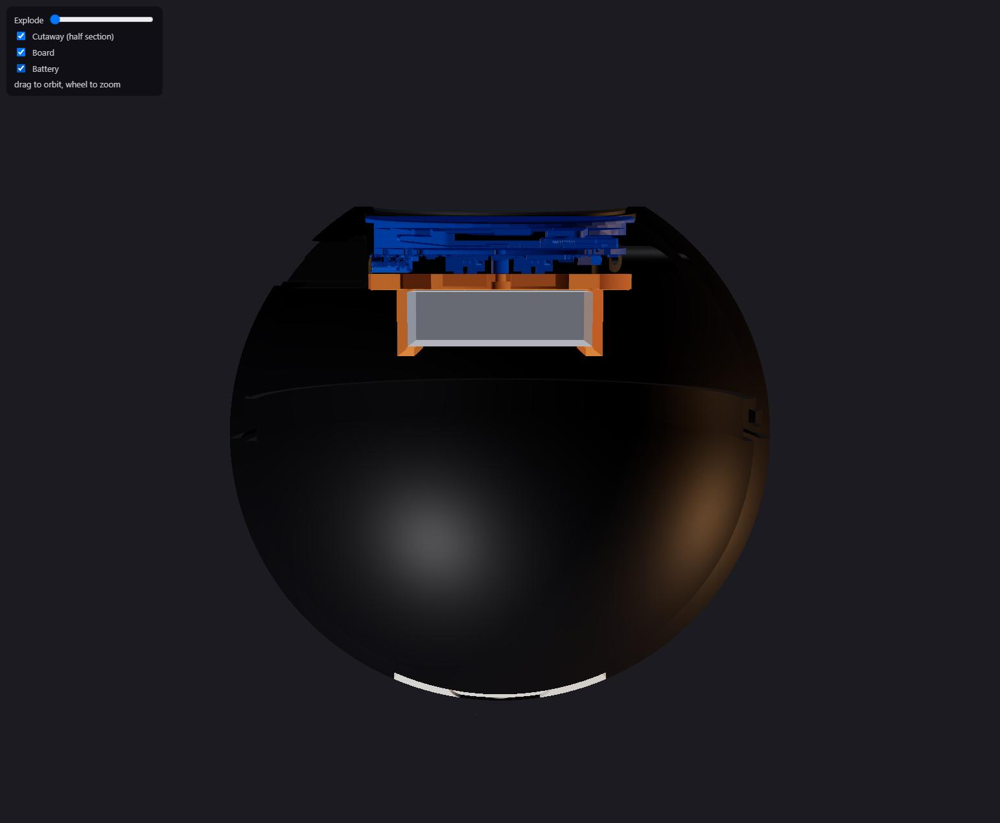
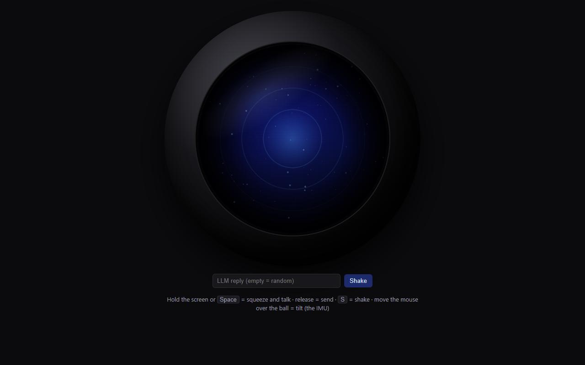
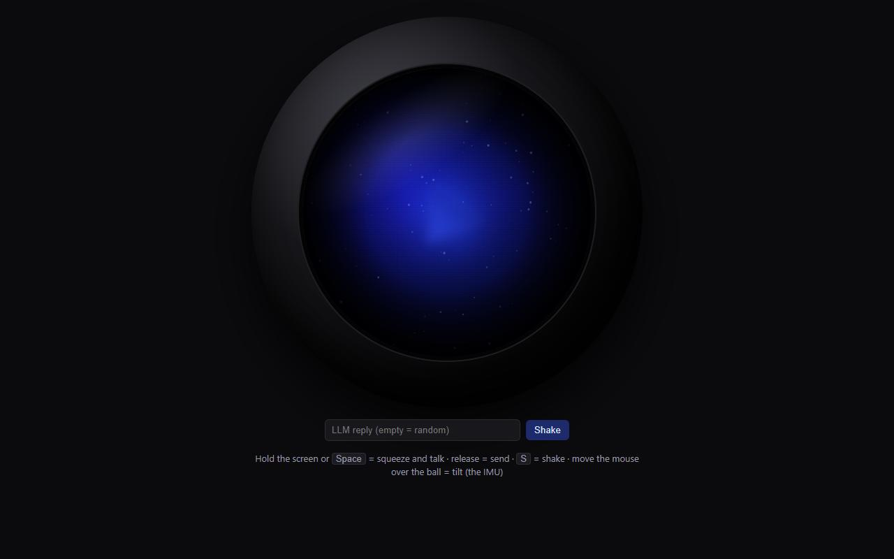
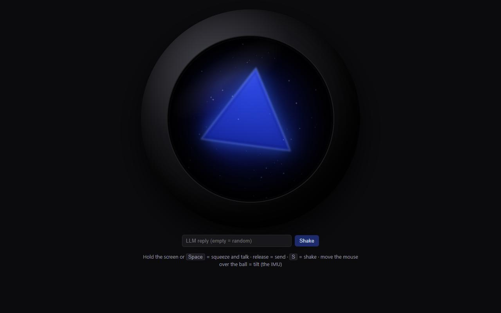
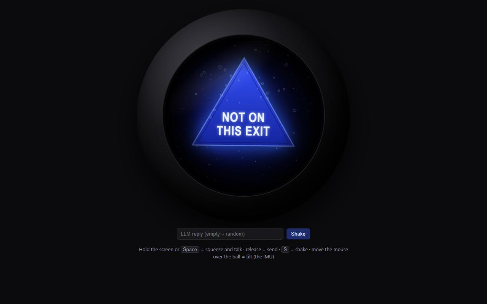

# Talking 8-ball

A 100 mm black 8-ball with a round 1.75" AMOLED for a window. Shake it, ask out loud, and the answer
(from an LLM on your PC) floats up on a blue triangle.

**Status:** shell designed and checked in CAD and in the slicer, not printed yet. The PC server works
(voice → Whisper → pi → answer), testable in the browser with your microphone. Firmware: not yet.

**Try it now, without the ball:** run `server\start.cmd`, open http://localhost:8788/, press **S** and
ask out loud. See [server/README.md](server/README.md).

| Concept | Exploded concept | CAD, exploded | CAD, cutaway |
|---|---|---|---|
|  |  |  |  |

The answer reveal (open `reveal.html`):

| Squeeze/talk | Thinking | Rising | Answer |
|---|---|---|---|
|  |  |  |  |

The concept images are AI-generated; the CAD renders are the real model.

## Repository

| Path | What |
|---|---|
| `cad/ball.py` | The whole mechanical design, parametric ([build123d](https://github.com/gumyr/build123d)) |
| `cad/slice.py` | Packs the print jobs (3MF with settings and painted supports), slices them and checks the G-code |
| `out/` | Generated STLs (print-oriented) and `assembly.step` |
| `print/` | Print-ready jobs: [print/README.md](print/README.md) |
| `viewer/index.html` | 3D viewer with explode and cutaway: run `python -m http.server` here, open `/viewer/` |
| `reveal.html` | Screen animation prototype at the panel's 466×466; live with the mic when served by the server |
| `server/` | The brain on your PC: Whisper + pi, and the ball's protocol: [server/README.md](server/README.md) |

### Regenerating

```bash
python -m venv .venv && .venv/Scripts/pip install build123d trimesh scipy networkx
# The board model is Waveshare's, not redistributed here: download
#   https://files.waveshare.com/wiki/ESP32-S3-Touch-AMOLED-1.75/ESP32-S3-Touch-AMOLED-1.75-3D.zip
# and unzip it to vendor/ws175/extracted/ (the script reads ESP32-S3-Touch-AMOLED-1_75.stp).
.venv/Scripts/python cad/ball.py --check     # STLs + STEP + interference checks (~4 min)
PRUSA_SLICER=/path/to/prusa-slicer-console .venv/Scripts/python cad/slice.py
```

`cad/slice.py` needs PrusaSlicer 2.9.6 and a datadir (`PRUSA_DATADIR`) holding `vendor/PrusaResearch.ini`
from PrusaSlicer's `resources/profiles` and a `PrusaSlicer.ini` that enables the MK4S 0.4 nozzle.

## Parts (sourced for Italy)

| Part | Qty | Notes |
|---|---|---|
| **Waveshare ESP32-S3-Touch-AMOLED-1.75** (SKU 31261) or **-1.75-B** (31262, adds a case and speaker you won't need) | 1 | Amazon.it, OpenELAB (ships from Munich), Waveshare's AliExpress store. **Not the "1.75C"**: it's a different board in an aluminium case. Has Wi-Fi, 2 mics, the QMI8658 motion sensor and the AXP2101 charger on board |
| LiPo 3.7 V **103450**, 2000 mAh, with protection circuit | 1 | 10 × 34 × 50 mm (the bay takes up to ~53 mm long and 10.5 mm thick). E.g. ellenne.it, ampul.eu, Amazon.it. **Not 103454** (54 mm long) |
| MX1.25 2-pin pigtail | 1 | Most LiPos come with PH2.0; the board's battery socket is **MX1.25**. **Check polarity against the BAT +/− marks on the board before plugging in** |
| M2 × 4 screw | 3 | Board → chassis (into the board's M2 brass standoffs, 3.5 mm tall). Not longer than 4 mm |
| M3 × 8 self-tapping screw (*autofilettante*) | 4 | Chassis → shell bosses |
| Foam tape, 0.8–1 mm (*biadesivo in schiuma*) | ~15 cm | A ring on the back of the window lip; cushions the glass |
| Zip tie, ≤ 3.5 mm wide | 1 | Optional, across the open end of the battery bay |
| Filament | ~120 g black, ~5 g white | PLA or PETG, matte black looks best |

Rough cost: board ~€40, battery ~€10–15, small parts ~€5.

### AliExpress (checked 2026-10-15)

| Part | Listing | Pick | Price then |
|---|---|---|---|
| Board | [Ingcool Technology Store](https://it.aliexpress.com/item/1005008985857452.html) (Waveshare's AliExpress partner) | **Standard version** | €48.09 (€59.39 with case) |
| LiPo 103450 2000 mAh | [Battery-lucky Store](https://it.aliexpress.com/item/1005002919536938.html) | 1 pezzo | €9.29. PH2.0 plug; 4 reviews report reversed wires |
| MX1.25 cable | [10 pcs, 28AWG](https://it.aliexpress.com/item/1005007277110532.html) | 2 pin, 10 cm | €2.35 |
| Screws | [JUIDINTO button head](https://it.aliexpress.com/item/1005004531602992.html) | M2 × 4 and M3 × 8 (2 orders) | ~€1.51 each |
| Foam tape | [black foam tape](https://it.aliexpress.com/item/4000803370856.html) | 1 mm thick | €4.19 |

Not the listings titled "Cassa in Lega" / aluminium case: those are the 1.75C.

## Print

**Print-ready jobs (3MF with settings, painted supports, sliced and checked) are in `print/`; see
[print/README.md](print/README.md).** `cad/slice.py` regenerates and re-checks them.
The table below is the short version. All STLs in `out/` are oriented for printing and checked watertight.

| File | Orientation | Supports | Notes |
|---|---|---|---|
| `test_seam_front.stl` + `test_seam_back.stl` | as is | none | **Print these first** (~15 g): they check the twist-lock fit on your printer |
| `front_half.stl` | rim down, window up | **only under the 4 screw bosses, the USB duct and the 2 pin guides** (painted in the 3MF) | Automatic supports would also fill the window ring and the twist-lock notches. 5 mm brim (the rim is narrow) |
| `back_half.stl` | spigot down, "8" up | none | Brim recommended |
| `chassis.stl` | plate down | none | |
| `eight_disc_white.stl` + `eight_ink_black.stl` | as is | none | Multi-material: load both as one object, white + black. Single colour: print the disc in white and fill the "8" recess with a black paint marker |
| `stand.stl` | as is | none | Optional ring so the ball sits window-up |

0.2 mm layers (0.12 for the disc), 3–4 walls, 15% infill.

## Assembly

1. **Window foam:** stick a ring of foam tape on the inside of the window lip (the ledge in front of the glass).
2. **Board → chassis:** 3 × M2 × 4 from under the plate into the board's brass standoffs.
3. **Battery:** connect it to the BAT socket (check polarity), slide the cell into the bay from the open end, zip tie if you like.
4. **Into the front half:** lay the front half window-down, lower the board + chassis in (USB-C toward the rectangular port), 4 × M3 × 8 into the bosses. Snug, not tight: the screws only compress the foam.
5. **Close:** turn the back half until its 3 lugs drop into the slots, push, twist about 28° until it clicks past the detent. Twist back to open.
6. **The 8:** glue the disc into the recess (CA or E6000).

Charge through the USB-C port by the window. The two pinholes next to it are the PWR and BOOT buttons
(paperclip). The two tiny holes on the other side of the port feed the microphones.

## Design facts (in `cad/ball.py`)

- Board geometry comes from Waveshare's STEP and drawing: glass Ø48.96, Ø46 PCB, 12.7 mm total depth,
  M2 standoffs at (±13.75, −14.70) and (0, 20.50), USB-C, mics and side buttons at the edge.
- Window: Ø45.5 opening (visible area Ø44.16), 1.2 mm lip, glass located by a Ø49.4 counterbore, 0.6 mm
  gap for the foam.
- Seam: male spigot on the back half, 3 lugs, 0.25 mm clearances, 0.2 mm detent interference. If the
  test rings are too tight or loose, change `SOCK_R`, `SLOT_Z` or the bump in `front_half()`.
- `SPEAKER = True` adds a pocket and grille for Waveshare's 2030 cavity speaker (20 × 30 × 5.5).
  It builds and clears the shell, but has not been through the full `--check` or the viewer.
- `python cad/ball.py --check` (with the `.venv`) reruns the interference checks: halves locked, lugs
  sliding in, board/chassis/battery vs shells, inserting the board + chassis, and seating a USB-C plug
  (12.4 × 6.5 overmold; bulkier cable ends won't reach).

## Not verified yet

Nothing has been printed. The geometry is checked in CAD only. Untested on hardware:

- Twist-lock tolerances on a real printer (hence the test rings).
- Shake-to-wake: the plan is QMI8658 wake-on-motion on INT2 (GPIO21) to wake the ESP32-S3 from deep
  sleep. Check this with Waveshare's examples.
- Whether plugging in USB powers the board on from off (the AXP2101 normally does); otherwise use the
  PWR pinhole.
- How well the mics hear through two 1.3 mm holes in a closed ball.
